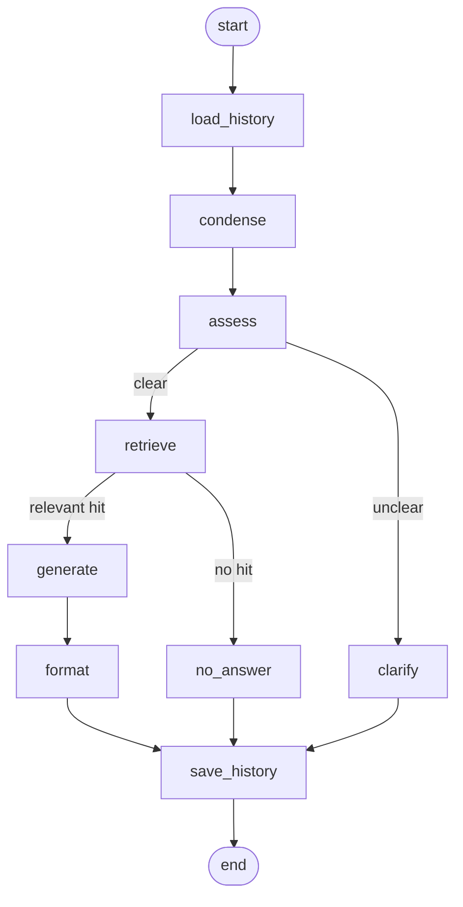

# DocuQuery – RAG backend

## Problem

A large webshop sells household and DIY appliances, and every product comes with a user manual. These manuals run to many pages, so customers and customer support agents struggle to find specific answers in them. The target users are customers before a purchase, who compare product features and technical data; customers after a purchase, who turn to the manual with questions about usage, maintenance or troubleshooting; and customer support agents, who want to give accurate answers quickly. DocuQuery is an HTTP API that the webshop's search box can be built on. Users ask their question in natural language, for example: "How often should I descale the KV-200 coffee maker?" The system answers from the relevant passages of the manuals rather than from a manual as a whole. The answer also names its source, meaning the product and the manual section. This lets users verify the answer without having to read the entire document.

### Example questions

- **Usage:** How do I start the espresso program on the KV-200 coffee maker?
- **Maintenance:** How often should I descale the KV-200 coffee maker?
- **Troubleshooting:** Why is the red light flashing on the drill, and what should I do?
- **Technical data:** What are the maximum speed and the power of the impact drill?
- **Safety:** Can I use the chainsaw in the rain, and what protective equipment do I need?

### Scope and limitations

- Answers come exclusively from the user manuals.
- Price, stock, orders and product recommendations are not part of the application.
- The webshop's search interface (UI) is out of scope; the prototype provides only the API.
- There is no authentication.
- There is no quality measurement (answer quality is not evaluated).
- Conversation history is kept per `session_key`, in memory only, and is lost on restart.

## Sample data

Real manufacturer manuals are copyrighted, so the repository ships its own short manuals in `data/sample/`. All products and brands in them (KV-200, KV-300, DR-450, CS-350, RV-700, WM-800, AP-120) are fictional, and the documents contain no confidential or real manufacturer content. Each manual is a markdown file with the same sections: Safety, Setup, Usage, Maintenance, Troubleshooting and Technical data. The set includes two similar coffee makers (KV-200 and KV-300) with different descaling intervals, so retrieval has to pick the right product.

### Questions the documents can answer

- How do I start the espresso program on the KV-200 coffee maker? (`kv-200-espresso-coffee-maker.md`, Usage)
- How often should I descale the KV-200 coffee maker? (`kv-200-espresso-coffee-maker.md`, Maintenance: every 60 days or 200 brew cycles. The KV-300 drip coffee maker differs: every 30 days.)
- Why is the red light flashing on the DR-450 drill, and what should I do? (`dr-450-cordless-impact-drill.md`, Troubleshooting)
- What are the maximum speed and the power of the DR-450 impact drill? (`dr-450-cordless-impact-drill.md`, Technical data: 2000 rpm, 600 W)
- Can I use the CS-350 chainsaw in the rain, and what protective equipment do I need? (`cs-350-electric-chainsaw.md`, Safety)

### Questions the documents cannot answer

- How much does the KV-200 coffee maker cost?
- Is the WM-800 washing machine in stock?
- How do I descale the KV-500 coffee maker? (this product is not in the set)
- Which smartphones can control the RV-700 robot vacuum? (no manual states this)

## Indexing

There is no upload API. When the application starts, it loads the manuals from `DATA_DIR` (default `data/sample/`), splits them, embeds the chunks and writes them to the vector store. Indexing runs in a background task, so the server starts immediately. Until indexing has succeeded, endpoints that need the index respond with `503` and the code `INDEX_NOT_READY`. If the data directory is missing or empty, the state becomes `failed` with a clear message, the app still starts and the same `503` is returned. The state (`indexing`, `ready` or `failed`, document and chunk counts, embedding model, timestamp, error) is kept on `app.state.index_status`.

The same pipeline runs from the command line:

```bash
uv run python -m app.ingest
```

It prints a summary and exits with 0 on success and 1 (with the error message) when indexing failed. Ollama must be running with the embedding model pulled (`ollama pull nomic-embed-text`) when `LLM_PROVIDER=ollama`.

Settings: `DATA_DIR`, `INDEX_DIR`, `CHROMA_COLLECTION`, `CHUNK_SIZE` and `CHUNK_OVERLAP` (see `.env.example`).

### Chunking

Each manual is split along its `## ` sections, and every section is split on its own with a recursive character splitter (`CHUNK_SIZE`, `CHUNK_OVERLAP`). Text is never merged across sections, so a chunk answers from exactly one part of one manual (for example "Maintenance" of the KV-200). Every chunk carries metadata: source file, product ID and name (parsed from the `# <ID> – <name>` title) and section title, plus a stable, unique chunk ID. These are the fields the answer later reports as its sources. The chunk text starts with a short `<ID> <name> - <section>` line so similar products (KV-200 and KV-300) stay distinguishable. Files without the title heading are logged and skipped.

### Vector store

Chroma runs embedded and is persisted to `INDEX_DIR` (`./data/index`). It needs no extra service, keeps the setup to a single process and is enough for a manual set of this size. The collection name is `CHROMA_COLLECTION` plus the sanitized embedding model name, so indexes built with different embedding models never mix.

### Startup indexing trade-offs

- A fingerprint (SHA-256 over the sorted file names and contents, the embedding model, the chunk size and the overlap) is stored next to the index. If it is unchanged and all chunks are present, the persisted index is reused and no embedding calls are made. Otherwise the old chunks are deleted and the index is rebuilt without duplicates.
- A first start (or a start after a change) is slower because every chunk is embedded; later starts are fast.
- With several instances, each one indexes on its own (there is no coordination between instances), which costs duplicate embedding work. A shared index built once by a separate job is the next step.

## Conversation history

Follow-up questions work when the client sends a `session_key` (8-64 characters: letters, digits, `-`, `_`) with the question.

- **How it works:** history is a dict of `session_key` to messages, guarded by an `asyncio.Lock`. The history is loaded before the question is processed and saved afterwards (question plus answer). Clarifying questions asked by the assistant are remembered too, so the user's next message is read in that context.
- **Optional key:** the server never generates a key. Without a `session_key` no history is kept and every question stands alone. The response echoes the key (or `null`).
- **Setting:** `HISTORY_MAX_MESSAGES` (default 20, minimum 1) is the number of most recent messages kept per session; older messages are dropped.
- **Limits:** history lives in process memory only and is lost on restart. Several instances do not share it, so a follow-up routed to another instance starts empty. It is not a LangGraph checkpointer, and the key is not authentication: anyone who knows a key can read and extend that session. The number of sessions is not bounded.
- **Production alternative:** store the transcripts in Redis (with a TTL) or PostgreSQL, behind the same get/save interface, so that all instances share them and they survive restarts.

## Question flow

Every question runs through a LangGraph graph that is compiled once at startup. The state (question, history, hits, answer, sources, status) is created per request, so requests share nothing except the session store.



- `load_history`: loads the stored messages for the `session_key` (nothing without a key).
- `condense`: with history, one LLM call rewrites a follow-up into a standalone question; without history it makes no LLM call.
- `assess`: one LLM call decides whether the question is clear enough to search. If the answer cannot be parsed, the question is treated as clear so retrieval still runs.
- `clarify`: the LLM asks one targeted clarifying question (`status: clarification_needed`); retrieval and generation are skipped.
- `retrieve`: fetches the top `RETRIEVAL_TOP_K` chunks with relevance scores (0 to 1). If at least one score reaches `RETRIEVAL_RELEVANCE_THRESHOLD` the flow continues with `generate`, otherwise with `no_answer`.
- `generate`: answers from the chunks at or above the threshold only, and says so when the context does not contain the answer.
- `no_answer`: a fixed "no relevant information" reply (`status: no_answer`, no sources, no LLM call).
- `format`: sets `status: answered` and the sources (product ID and name, section, source file, chunk ID) of the chunks used, and logs them.
- `save_history`: appends the question and the reply (answer or clarifying question) to the session.

Provider errors (timeout, unavailable, rate limited) leave the graph unchanged as domain errors and nothing is saved to the history; unexpected errors are wrapped in a generic pipeline error without internal details.

## Model providers

The chat model and the embeddings are chosen with `LLM_PROVIDER` (`azure`, `gemini` or `ollama`, default `ollama`) and `EMBEDDING_PROVIDER` (defaults to `LLM_PROVIDER`). A missing variable or an unknown value stops the application at startup with an error that names the variable; there is never a silent fallback. Every external call uses `LLM_TIMEOUT_SECONDS` / `EMBEDDING_TIMEOUT_SECONDS` and `MAX_RETRIES`.

For the cloud providers, vendor failures are translated into three domain errors: a timeout (`llm_timeout`, HTTP 504), an unreachable provider or a 5xx answer (`llm_unavailable`, 503) and rate limiting (`llm_rate_limited`, 429). An HTTP 429 is retried at most `MAX_RETRIES` times with an exponential backoff starting at `RETRY_BACKOFF_SECONDS` before the rate-limit error is raised. This sits on top of the vendor client's own retries, so the worst case is more calls than `MAX_RETRIES` alone suggests. Error messages never contain keys or vendor messages.

Ollama runs locally, so there are no rate limits and no retries. Its failures use the same domain errors (a timeout is `llm_timeout`, 504; an unreachable server or a model that is not pulled is `llm_unavailable`, 503), and the message names the base URL and, for a missing model, the `ollama pull <model>` command.

### Configure Azure OpenAI

Azure OpenAI is the primary, production-like mode: a managed service with a stable API, predictable quotas and enterprise data-handling terms. Create a chat deployment and an embedding deployment in your Azure OpenAI resource, then set:

```env
LLM_PROVIDER=azure
AZURE_OPENAI_API_KEY=<key>
AZURE_OPENAI_ENDPOINT=https://<resource>.openai.azure.com
AZURE_OPENAI_API_VERSION=2024-10-21
AZURE_OPENAI_CHAT_DEPLOYMENT=<chat deployment name>
AZURE_OPENAI_EMBEDDING_DEPLOYMENT=<embedding deployment name>
```

`AZURE_OPENAI_API_VERSION` has a default and may be omitted. The deployment names are the names you gave the deployments, not the model names.

### Configure Google Gemini

Gemini is the cloud mode that can be tried for free: create an API key in Google AI Studio and set:

```env
LLM_PROVIDER=gemini
GOOGLE_API_KEY=<key>
GEMINI_CHAT_MODEL=gemini-3.1-flash-lite
GEMINI_EMBEDDING_MODEL=gemini-embedding-001
```

Only `GOOGLE_API_KEY` is required. `gemini-3.1-flash-lite` is the small, low-latency, low-cost model, which is enough for answering from a few retrieved manual chunks and stays within free-tier rate limits. `gemini-embedding-001` is Google's general-purpose text embedding model. The free tier is rate limited, so a first indexing run may hit 429 answers; they are retried with backoff.

Availability of the embedding model: the key-gated integration test calls `embed_query` with `gemini-embedding-001`. It was not executed while this section was written (no key was available), so confirm it with your own key:

```bash
GOOGLE_API_KEY=<key> uv run pytest -m integration -k gemini
```

You can also list the models your key can use with `GET https://generativelanguage.googleapis.com/v1beta/models?key=<key>`. If the embedding model is not available to you, set `GEMINI_EMBEDDING_MODEL` to another model from that list.

### Configure Ollama (free local mode)

Ollama runs the chat model and the embeddings on your own machine: no account, no key, no cost. It is the default provider.

1. Install Ollama from https://ollama.com/download (Windows, macOS, Linux).
2. Pull the two default models:

   ```bash
   ollama pull llama3.2:3b
   ollama pull nomic-embed-text
   ```

3. Make sure the server is running. The desktop installers start it automatically; otherwise run `ollama serve`. It listens on `http://localhost:11434`.
4. Configure the application (these are the defaults, so a plain `.env` copied from `.env.example` already works):

   ```env
   LLM_PROVIDER=ollama
   # EMBEDDING_PROVIDER defaults to LLM_PROVIDER; set it only for a mixed setup
   OLLAMA_BASE_URL=http://localhost:11434
   OLLAMA_CHAT_MODEL=llama3.2:3b
   OLLAMA_EMBEDDING_MODEL=nomic-embed-text
   ```

5. Build the index and start the application:

   ```bash
   uv sync
   uv run python -m app.ingest
   uv run uvicorn app.main:app --reload
   ```

No key variable is needed. The index collection for this setup is `manuals-ollama-nomic-embed-text`. The question-answering endpoint is not part of the application yet, so local mode is verified today at the level of the chat model, the embeddings and the retriever (see the integration test below).

If Ollama is not running, ingest prints `Ollama is not reachable at <base url>. Start it with 'ollama serve' or check OLLAMA_BASE_URL` and exits with 1; if a model is missing, the message names it and says `ollama pull <model>`. The application itself still starts, and endpoints that need the index answer `503`.

Integration test against the real server (indexes one sample manual into a temporary directory, retrieves a relevant chunk and makes one chat call):

```bash
uv run pytest -m integration -k ollama
```

It is skipped, not failed, when Ollama is unreachable or a configured model is not pulled.

Which of these commands were run: the ingest command was run with Ollama stopped and printed the unreachable message above, and the integration test was run with Ollama stopped and was skipped. The installation, the pulls and the successful runs against a live server were not run, because Ollama is not installed on the machine where this section was written.

#### Hardware, speed and quality (estimates, not measured)

These figures are rough estimates from the public model sizes; they were not measured on this project.

- **Memory:** `llama3.2:3b` is about a 2 GB download and needs roughly 3 to 4 GB of free RAM (or VRAM) while loaded; `nomic-embed-text` is about 270 MB and needs well under 1 GB. Plan for about 8 GB of RAM in total, with room for the operating system and the application.
- **CPU or GPU:** both models run on a CPU only. A GPU with 4 GB or more of VRAM (or Apple Silicon) is considerably faster but not required.
- **Speed on a CPU:** expect a few seconds before the first token and roughly 5 to 20 generated tokens per second on a recent laptop CPU, so a short answer takes several seconds to half a minute. Indexing the seven sample manuals should take on the order of tens of seconds to a few minutes on a CPU the first time; later starts reuse the persisted index. Raise `LLM_TIMEOUT_SECONDS` on slow machines, and note that the first request after a pause also loads the model into memory.
- **Quality limits:** a 3B model gives noticeably weaker answers than the cloud models. It can ignore the retrieved context or make up details (hallucination), follows instructions less reliably, handles long context poorly and is clearly weaker in languages other than English. The sample manuals are in English, which is the best case.
- **Concurrency:** a single local server processes few requests at a time; parallel questions queue up. This mode is meant for development, demos and offline use.

### Mixed setup: cloud chat with local embeddings

Chat answers can come from Gemini while the embeddings stay local and free:

```env
LLM_PROVIDER=gemini
EMBEDDING_PROVIDER=ollama
GOOGLE_API_KEY=<key>
```

Run `ollama pull nomic-embed-text` first. The index collection name contains the embedding model, so changing the embeddings builds a new index instead of mixing vectors: this setup uses `manuals-ollama-nomic-embed-text`, while `EMBEDDING_PROVIDER=gemini` uses `manuals-gemini-gemini-embedding-001` (names checked with the provider factory). The old collection stays in `INDEX_DIR` unused.

### Integration tests

```bash
uv run pytest -m integration
```

The Azure and Gemini tests make one real chat call and one embedding call. They are skipped (not failed) when the credentials are not set. The Ollama tests are skipped when the server is unreachable or a model is not pulled (see "Configure Ollama").
