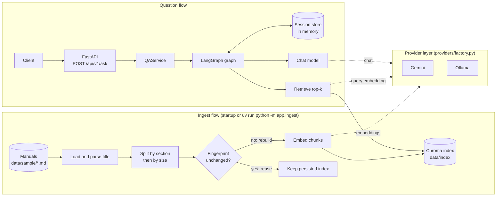

# DocuQuery – RAG backend

DocuQuery is an HTTP API (FastAPI) that answers natural-language questions about the user manuals of household and DIY appliances with retrieval-augmented generation, and returns the sources it used: the product and the manual section. It runs with Google Gemini (primary, cloud) or fully locally with Ollama, switched by environment variables only.

## Contents

- [Problem and features](#problem-and-features)
- [Quick start](#quick-start)
- [Architecture](#architecture)
- [API](#api)
- [Model providers](#model-providers)
- [Docker setup](#docker-setup)
- [Concurrency and scaling](#concurrency-and-scaling)
- [Tests](#tests)
- [Known limitations and next steps](#known-limitations-and-next-steps)

## Problem and features

A large webshop sells household and DIY appliances, and every product comes with a long user manual in which customers and support agents struggle to find specific answers. The target users are customers before a purchase (comparing features and technical data), customers after a purchase (usage, maintenance, troubleshooting) and customer support agents who want accurate answers quickly. DocuQuery is an HTTP API that an AI assistant on the webshop's pages can be built on. Users ask in natural language, the system answers from the relevant passages of the manuals and names its sources (product and manual section), so the answer can be verified without reading the whole document.

### Features

- **Q&A with sources:** `POST /api/v1/ask` answers from the retrieved manual chunks only and lists each source it used.
- **Clarifying questions:** a well-formed but unclear question gets a clarifying question instead of a guess (`status: clarification_needed`).
- **No-answer handling:** when no chunk is relevant enough, a fixed "no relevant information" reply is returned without calling the model (`status: no_answer`).
- **Session history:** follow-up questions are interpreted with the earlier conversation, kept in memory per `session_key`.
- **Product filter:** the optional `product_id` restricts the search to one product's manual.
- **Health endpoints:** liveness and readiness (indexing state, optional LLM check).
- **Switchable providers:** Gemini or Ollama for the chat model and for the embeddings, chosen independently in the environment.
- **Startup indexing:** the manuals are indexed at startup; an unchanged index is reused.
- **Unified errors, structured logging, concurrency limit and Docker setup.**

### Sample data

Real manufacturer manuals are copyrighted, so `data/sample/` holds short, fictional manuals (KV-200, KV-300, DR-450, CS-350, RV-700, WM-800, AP-120) with no confidential or real manufacturer content. Each one has the same sections: Safety, Setup, Usage, Maintenance, Troubleshooting and Technical data. Two similar coffee makers (KV-200 and KV-300) have different descaling intervals, so retrieval has to pick the right product.

### Example questions

- **Usage:** How do I start the espresso program on the KV-200 coffee maker?
- **Maintenance:** How often should I descale the KV-200 coffee maker? (every 60 days or 200 brew cycles; the KV-300 needs it every 30 days)
- **Troubleshooting:** Why is the red light flashing on the DR-450 drill, and what should I do?
- **Technical data:** What are the maximum speed and the power of the DR-450 impact drill? (2000 rpm, 600 W)
- **Safety:** Can I use the CS-350 chainsaw in the rain, and what protective equipment do I need?

Questions the manuals cannot answer, which get a "no relevant information" reply:

- How much does the KV-200 coffee maker cost? (price is not in the manuals)
- Is the WM-800 washing machine in stock? (stock is not in the manuals)
- How do I descale the KV-500 coffee maker? (this product is not in the set)
- Which smartphones can control the RV-700 robot vacuum? (no manual states this)

## Quick start

Every way to start the application is described here; the later sections do not repeat these steps.

### Prerequisites

- Python 3.12 (uv installs it if it is missing) and [uv](https://docs.astral.sh/uv/)
- Local mode: [Ollama](https://ollama.com/download); cloud mode: a Google AI Studio API key
- Docker setups: Docker with Compose (Python, uv and Ollama are then not needed on the host)

### 1. Get the code and the configuration

```bash
git clone https://github.com/Regdani/docuquery-rag-backend.git
cd docuquery-rag-backend
uv sync
cp .env.example .env
```

`uv sync` installs the exact versions pinned in `uv.lock` (not needed for Docker). `.env.example` holds names and safe defaults only, no secrets, is set up for local mode and documents every other setting. `.env` is git-ignored, so `GOOGLE_API_KEY` goes only there. Then pick one of the setups below.

### 2a. Local mode (Ollama)

No account, no key, no cost; after the first model download it works offline.

1. Pull the two models (a one-time download of about 2.3 GB):

   ```bash
   ollama pull llama3.2:3b
   ollama pull nomic-embed-text
   ```

2. Make sure the Ollama server is running (the desktop installers start it; otherwise run `ollama serve`). It listens on `http://localhost:11434`.
3. Check `.env` (a copy of `.env.example` already contains these values):

   ```env
   LLM_PROVIDER=ollama
   EMBEDDING_PROVIDER=ollama
   EMBEDDING_MODEL=nomic-embed-text
   OLLAMA_BASE_URL=http://localhost:11434
   OLLAMA_CHAT_MODEL=llama3.2:3b
   ```

4. Build the index and start the server:

   ```bash
   uv run python -m app.ingest
   uv run uvicorn app.main:app --reload
   ```

### 2b. Cloud mode (Gemini)

1. Create an API key in Google AI Studio and set these values in `.env`:

   ```env
   LLM_PROVIDER=gemini
   EMBEDDING_PROVIDER=gemini
   EMBEDDING_MODEL=gemini-embedding-001
   GOOGLE_API_KEY=<key>
   GEMINI_CHAT_MODEL=gemini-3.1-flash-lite
   ```

2. Build the index and start the server:

   ```bash
   uv run python -m app.ingest
   uv run uvicorn app.main:app --reload
   ```

### 2c. Docker, local mode (Ollama)

Compose reads every setting from `.env` and stops with an error if the file is missing. A `.env` copied from `.env.example` already holds the Ollama values.

```bash
docker compose up --build -d
docker compose exec ollama ollama pull llama3.2:3b
docker compose exec ollama ollama pull nomic-embed-text
docker compose run --rm app python -m app.ingest
docker compose restart app
```

Pull both models before the ingest step: without them indexing fails, and `/health/ready` and `/api/v1/ask` return `503`. The models are kept in the `ollama` volume, so the pulls are needed only once. Plan for about 8 GB of RAM and several GB of free disk.

### 2d. Docker, cloud mode (Gemini)

Set the Gemini values from "2b" in `.env`, then start only the cloud service (Ollama is not started):

```bash
docker compose --profile cloud up --build -d app-cloud
docker compose run --rm app-cloud python -m app.ingest
```

Both app services publish port 8000, so run only one of them at a time. Stop everything with `docker compose --profile cloud down` (add `-v` to delete the index and model volumes).

### 2e. Mixed mode (one provider for chat, the other for embeddings)

Chat and embeddings are configured separately, so they can come from different providers, in either direction. Set the matching lines in `.env` and start as in "2a" (or "2c" in Docker, because the `app` service starts Ollama). Only the model of the local side has to be pulled.

```env
# Gemini chat, local Ollama embeddings
LLM_PROVIDER=gemini
EMBEDDING_PROVIDER=ollama
EMBEDDING_MODEL=nomic-embed-text
GOOGLE_API_KEY=<key>

# or: local Ollama chat, Gemini embeddings
LLM_PROVIDER=ollama
EMBEDDING_PROVIDER=gemini
EMBEDDING_MODEL=gemini-embedding-001
GOOGLE_API_KEY=<key>
```

### 3. Ask a first question

The ingest step is optional: the server also indexes in the background at startup and is reachable at once, but `/api/v1/ask` answers `503 INDEX_NOT_READY` until http://localhost:8000/health/ready returns `200`. Then ask a question or use the Swagger UI:

```bash
curl -s -X POST http://localhost:8000/api/v1/ask \
  -H "Content-Type: application/json" \
  -d '{"question": "What are the maximum speed and the power of the DR-450 impact drill?"}'
```

| URL | What it is |
|---|---|
| http://localhost:8000/docs | Swagger UI with request and response examples (also `/redoc`, `/openapi.json`) |
| http://localhost:8000/health | Liveness check |
| http://localhost:8000/health/ready | Readiness check (indexing state) |
| http://localhost:8000/api/v1/ask | Ask endpoint (`POST`) |

Locally uvicorn listens on `127.0.0.1:8000` (`--port <port>` changes it); in Docker the host port is `APP_PORT` (default `8000`). The local 3B model sometimes answers a clear question with a clarifying question; name the product, rephrase, or use Gemini.

## Architecture

### Overview



### Project structure

```
app/
  main.py              FastAPI app factory and lifespan (indexing task, graph built once)
  ingest.py            CLI: load, chunk, embed, persist the index
  api/                 HTTP layer, no RAG logic
    routes.py          POST /api/v1/ask
    health.py          GET /health and GET /health/ready
    schemas.py         request and response models with examples
    handlers.py        exception handlers (unified error body)
    deps.py            FastAPI dependencies (service and index status from app.state)
  services/
    qa_service.py      QAService: runs the graph for one question (no HTTP, no provider imports)
  memory/
    store.py           InMemorySessionStore (session_key to messages, asyncio.Lock)
  rag/                 depends on langchain-core abstractions only
    graph.py           LangGraph question flow and its nodes
    memory_nodes.py    load_history and save_history nodes
    state.py           per-request graph state
    prompts.py         prompts of the LLM steps
    loader.py          reads the markdown manuals
    chunking.py        section-based chunks with metadata
    indexing.py        index build, fingerprint check and reuse
    index_status.py    indexing state shown by /health/ready
    limiter.py         model-call concurrency limit
  providers/
    factory.py         the only place that selects and imports providers (Gemini, Ollama, Chroma)
    resilience.py      timeout, retry and error translation for provider calls
  core/                Settings (all env vars), error classes, logging setup
data/sample/           the fictional sample manuals (data/index/ is generated and git-ignored)
tests/                 fakes.py (test doubles), unit/ and api/ (offline), integration/
scripts/load_probe.py  parallel request probe for the concurrency limit
.github/workflows/     CI: lint, format check, type check and offline tests
```

Rules that keep the layers apart:

- **Provider isolation:** provider packages (`langchain_google_genai`, `langchain_ollama`, `langchain_chroma`, `chromadb`) are imported only inside `app/providers/`, lazily in the provider's create function. Everything else uses the langchain-core abstractions (`BaseChatModel`, `Embeddings`, `VectorStore`), so a provider can be replaced without touching the graph.
- **Selection by config only:** the only provider branching is in `providers/factory.py`; a missing or unknown value stops startup with an error naming the variable, never a silent fallback.
- **Fakes only in tests:** there is no mock provider. The test doubles live in `tests/fakes.py` and are injected through FastAPI dependency overrides or passed to the graph builder.

### Question flow

Every question runs through a LangGraph graph compiled once at startup; its state is created per request.


- `load_history`: loads the stored messages for the `session_key` (empty for a new conversation).
- `condense`: with history, one LLM call rewrites a follow-up into a standalone question. Without history this step is skipped and the question is passed on unchanged; the later steps still call the LLM as usual.
- `assess`: one LLM call decides whether the question is clear enough to search. If the answer cannot be parsed, the question is treated as clear so retrieval still runs.
- `clarify`: the LLM asks one targeted clarifying question; retrieval and generation are skipped.
- `retrieve`: fetches the top `RETRIEVAL_TOP_K` chunks (1 to 20) with relevance scores (0 to 1). If at least one score reaches `RETRIEVAL_RELEVANCE_THRESHOLD` the flow continues with `generate`, otherwise with `no_answer`.
- `generate`: answers from the chunks at or above the threshold only, and says so when the context does not contain the answer.
- `no_answer`: a fixed "no relevant information" reply, no sources, no LLM call.
- `format`: sets `status: answered` and the sources of the chunks used, and logs them.
- `save_history`: appends the question and the reply (answer or clarifying question) to the session.

Provider errors (timeout, unavailable, rate limited) leave the graph as domain errors and nothing is saved to the history; unexpected errors become a generic `RAG_PIPELINE_ERROR` (502) without internal details.

### Indexing

At startup a background task loads the manuals from `DATA_DIR` (default `data/sample/`), splits and embeds them and writes the chunks to Chroma in `INDEX_DIR` (`./data/index`). A missing or empty data directory sets the state to `failed`; the app still starts. The ingest command runs the same pipeline, prints a summary and exits with 0 on success and 1 on failure. Settings: `DATA_DIR`, `INDEX_DIR`, `CHROMA_COLLECTION`, `CHUNK_SIZE`, `CHUNK_OVERLAP`.

- **Chunking:** a section starts at a level-2 heading (`## Maintenance`) and runs until the next one; text before the first `##` is the introduction, and `###` sub-headings stay inside their section. Each section is then split on its own with a recursive character splitter. Every chunk carries the source file, the product ID and name (parsed from the `# <ID> – <name>` title), the section title and a stable chunk ID; these are the fields the answer reports as its sources. Files without the title heading are logged and skipped.
- **Index reuse:** the collection name is `CHROMA_COLLECTION` plus the embedding model name (for example `manuals-ollama-nomic-embed-text`). A fingerprint (SHA-256 over the file names and contents, the embedding model and the chunk settings) is stored next to the index. If it is unchanged and all chunks are present, the index is reused without any embedding call; otherwise it is rebuilt without duplicates.

### Design trade-offs

Each item gives the choice, the alternative and the reason. Defaults are those of `app/core/config.py` and `.env.example`.

- **Embedded Chroma instead of a vector-store server.** A server store (Chroma server mode, pgvector, Qdrant) could be shared between instances, but it adds a service to run and operate. For seven manuals and a single process the embedded store keeps the setup to one command. The cost: instances cannot share one index.
- **Section-based chunking with `CHUNK_SIZE=800` and `CHUNK_OVERLAP=100`.** A fixed-size splitter over the whole text is simpler but cuts across sections and mixes products. Section-based chunks stay inside one part of one manual, which gives a clean source for every answer. 800 characters fit a typical section in one or two chunks and stay small enough for a precise match; the overlap keeps a sentence on a boundary readable in both chunks. Each chunk text also starts with a `<ID> <name> - <section>` line, so similar products (KV-200 and KV-300) stay distinguishable for the embeddings, at the cost of a few tokens per chunk.
- **`RETRIEVAL_TOP_K=4` and `RETRIEVAL_RELEVANCE_THRESHOLD=0.3`.** Four chunks are enough for a question about one topic and keep the prompt short. Below the threshold no chunk is used and the model is not called; always passing the top chunks would make the model more likely to answer questions the manuals do not cover. The threshold is a reasoned default for the default embeddings, not a tuned value.
- **Startup indexing in the background instead of an upload API or a separate ingest job.** The server starts at once and reports the indexing state on `/health/ready`. An upload API would need authentication and storage, and a separate job would need orchestration. The cost: every instance indexes on its own, and the first start is slow because every chunk is embedded.
- **A fingerprint with a full rebuild instead of incremental updates.** Incremental updates per file would save embedding calls but need change tracking per document and chunk. For seven manuals a full rebuild is cheap and cannot leave stale or duplicate chunks; the cost is that one changed file re-embeds every manual.
- **One collection per embedding model.** Vectors from different models are not comparable, so switching the embeddings builds a new collection instead of mixing vectors or searching with the wrong model. The cost: the old collection stays in `INDEX_DIR` until it is deleted by hand.
- **In-memory history instead of a store.** It needs no infrastructure and keeps the interface simple, but it is lost on restart and not shared between instances.
- **An LLM clarifying question instead of always answering.** A vague question such as "My machine doesn't work." gets one targeted question back instead of a guess that may cite the wrong product. The cost: one extra LLM call per question, and a small local model sometimes asks when the question was clear enough.
- **Limiting model calls per process instead of unbounded parallelism.** It protects the provider quota and, locally, the machine; an overloaded instance fails fast with `503 SERVER_BUSY` instead of hiding overload as latency.

## API

Swagger UI (`/docs`) shows request and response examples for every status and error.

### Ask endpoint

`POST /api/v1/ask` runs the question flow and returns the answer with the chunks it used.

| Field | Required | Description |
|---|---|---|
| `question` | yes | The question. Whitespace is trimmed; a blank question is a `422`. |
| `session_key` | no | 8-64 characters (letters, digits, `-`, `_`) linking follow-up questions. |
| `product_id` | no | Restricts retrieval to one product's manual (for example `KV-200`, case-insensitive). An unknown ID returns `404 PRODUCT_NOT_FOUND`; an empty string counts as absent. |

The response has `answer`, `status`, `sources`, `session_key` and `request_id`. Each source has `product_id`, `product_name`, `section`, `chunk_id`, `score` (0 to 1) and a `snippet` capped at `SNIPPET_MAX_CHARS`.

| `status` | Meaning | `sources` |
|---|---|---|
| `answered` | A grounded answer from relevant chunks | the chunks used |
| `clarification_needed` | The question is unclear; `answer` is a clarifying question | empty |
| `no_answer` | No chunk reached the relevance threshold | empty |

**Invalid vs unclear:** a technically invalid request (missing or wrong-typed field, malformed JSON, blank question, question longer than `MAX_QUESTION_LENGTH`, bad `session_key`) is a `422`. A well-formed but unclear question is not an error: it returns `200` with `status: clarification_needed`. The body is validated before the index check, so while indexing is running an invalid request still gets a `422` and a valid one gets `503 INDEX_NOT_READY`.

```bash
# A question
curl -s -X POST http://localhost:8000/api/v1/ask \
  -H "Content-Type: application/json" \
  -d '{"question": "How often should I descale the KV-200 coffee maker?"}'

# A follow-up: send the session_key returned by the previous answer (or your own key)
curl -s -X POST http://localhost:8000/api/v1/ask \
  -H "Content-Type: application/json" \
  -d '{"question": "And the KV-300?", "session_key": "demo-session-01"}'

# Restricted to one product
curl -s -X POST http://localhost:8000/api/v1/ask \
  -H "Content-Type: application/json" \
  -d '{"question": "How do I descale it?", "product_id": "KV-200"}'

# Unclear question: 200 with status "clarification_needed"
curl -s -X POST http://localhost:8000/api/v1/ask \
  -H "Content-Type: application/json" \
  -d '{"question": "How do I clean it?"}'

# Empty question: 422 with the unified error body
curl -s -X POST http://localhost:8000/api/v1/ask \
  -H "Content-Type: application/json" \
  -d '{"question": ""}'
```

### Errors

Every error uses the body `{"detail", "code", "request_id"}`; `detail` never contains a stack trace or internal exception text. A `422` adds `errors`, a list of `{"field", "message", "type"}` items, without echoing the submitted values:

```json
{
  "detail": "Invalid request: question: String should have at least 1 character",
  "code": "VALIDATION_ERROR",
  "request_id": "3f2b8c1e9d7a4e6f",
  "errors": [
    {"field": "question", "message": "String should have at least 1 character", "type": "string_too_short"}
  ]
}
```

| Status | `code` | When |
|---|---|---|
| 404 | `PRODUCT_NOT_FOUND` | `product_id` is not in the index |
| 404 / 405 | `NOT_FOUND`, `METHOD_NOT_ALLOWED`, ... | Unknown route, wrong method |
| 422 | `VALIDATION_ERROR` | Invalid request body |
| 502 | `LLM_UNAVAILABLE` | Provider unreachable or answering with a 5xx error |
| 502 | `LLM_EMPTY_RESPONSE` | The model returned an empty answer |
| 502 | `RAG_PIPELINE_ERROR` | Unexpected failure inside the question flow (its own code, so a bug is not reported as the model being unreachable) |
| 503 | `INDEX_NOT_READY` | Indexing is running or failed |
| 503 | `LLM_RATE_LIMITED` | Provider still rate limits after the bounded retries |
| 503 | `SERVER_BUSY` | No model slot became free within `CONCURRENCY_WAIT_SECONDS` |
| 504 | `LLM_TIMEOUT` | Provider did not answer within the timeout |
| 500 | `INTERNAL_ERROR` | Any other unhandled exception |

`LLM_RATE_LIMITED` and `SERVER_BUSY` carry a `Retry-After` header in seconds: the provider's value when it sends a number, otherwise `RATE_LIMIT_RETRY_AFTER_SECONDS` (default 5); for `SERVER_BUSY`, `CONCURRENCY_WAIT_SECONDS` rounded up.

### Health endpoints

Both are at the root, outside `/api/v1`, and are not affected by the index check.

- **`GET /health`** (liveness) returns `200` with `{"status": "ok"}` whenever the process is serving. It touches neither the index nor any provider.
- **`GET /health/ready`** (readiness) reports `state` (`indexing`, `ready` or `failed`), `document_count`, `chunk_count`, `embedding_model`, `last_indexed_at` and `error`. It returns `200` when the state is `ready` with at least one chunk, otherwise `503` with the same body.
- **`GET /health/ready?check_llm=true`** also sends one minimal request to the chat model and adds `"llm": {"status": "ok" | "unreachable" | "timeout"}`, bounded by `HEALTH_LLM_TIMEOUT_SECONDS`. It is off by default because it costs latency and tokens, and it never changes the status code.

```bash
curl -s http://localhost:8000/health
curl -s -i http://localhost:8000/health/ready
curl -s -i "http://localhost:8000/health/ready?check_llm=true"
```

### Conversation history

Without a `session_key` (or with an empty one) a request starts a new conversation: the server generates a random key and returns it. Sending that key (or your own) with the next question continues the conversation; an unknown key starts a new one under that key. Clarifying questions are stored too, so the next message is read in their context. `HISTORY_MAX_MESSAGES` (default 20) is the number of most recent messages kept per session.

### Logging

Logs go to stdout as `<time> <LEVEL> <logger> <message>` lines (in Docker: `docker compose logs -f app`); `LOG_LEVEL` sets the level (default `INFO`). Every request is logged with method, path, status, duration and `request_id` (health probes at DEBUG). Every `4xx` is logged at WARNING with the error code and, for `422`, the field names; every `5xx` at ERROR with the stack trace, in the log only. Each answer logs its sources; the question is logged truncated to `LOG_QUESTION_MAX_CHARS`, the request body is not logged. The `X-Request-ID` header is used when the client sends one, otherwise generated, and is returned in the response header and body.

## Model providers

Three variables choose the models, and all three are required:

| Variable | Values | Meaning |
|---|---|---|
| `LLM_PROVIDER` | `gemini`, `ollama` | Provider of the chat model |
| `EMBEDDING_PROVIDER` | `gemini`, `ollama` | Provider of the embeddings, independent of `LLM_PROVIDER` |
| `EMBEDDING_MODEL` | model name | `gemini-embedding-001` (Gemini) or `nomic-embed-text` (Ollama) |

There are no defaults and no fallbacks: a missing or unknown value stops the application and the ingest command at startup with an error that names the variable. Chat model names are provider-specific (`GEMINI_CHAT_MODEL`, `OLLAMA_CHAT_MODEL`). Every call has a timeout (`LLM_TIMEOUT_SECONDS`, `EMBEDDING_TIMEOUT_SECONDS`), and provider failures are translated into the same domain errors for both providers (`LLM_TIMEOUT`, `LLM_UNAVAILABLE`, `LLM_RATE_LIMITED`); messages never contain keys or vendor messages.

### Primary model (Gemini)

Gemini is the primary model: a managed API with stronger answers than a small local model, no hardware to run, and one key for both chat and embeddings. The free tier is enough to try the project; the paid tier lifts the rate limits for real traffic. `gemini-3.1-flash-lite` (the default chat model) is small, fast and cheap, which is enough for answering from a few retrieved chunks; `gemini-embedding-001` is Google's general-purpose embedding model.

An HTTP 429 is retried at most `MAX_RETRIES` times with exponential backoff from `RETRY_BACKOFF_SECONDS`, on top of the vendor client's own retries; the free tier may hit this during a first indexing run. If the embedding model is not available for your key, list your models with `GET https://generativelanguage.googleapis.com/v1beta/models?key=<key>` and set `EMBEDDING_MODEL` accordingly.

### Local alternative (Ollama)

Ollama runs the chat model and the embeddings on your own machine: no account, no key, no cost. The application reaches it through `OLLAMA_BASE_URL` (`http://localhost:11434` locally, `http://ollama:11434` in Docker Compose). There are no rate limits and no retries. If Ollama is not running or a model is missing, the error names the base URL or the `ollama pull <model>` command; the application still starts and the endpoints that need the index answer `503`.

Hardware, speed and quality (rough estimates from the public model sizes):

- **Memory:** `llama3.2:3b` needs roughly 3 to 4 GB of free RAM (or VRAM) while loaded, `nomic-embed-text` well under 1 GB. Plan for about 8 GB of RAM in total.
- **CPU or GPU:** both run on a CPU only; a GPU with 4 GB or more of VRAM (or Apple Silicon) is considerably faster but not required.
- **Speed on a CPU:** a few seconds before the first token and roughly 5 to 20 tokens per second, so a short answer takes several seconds to half a minute. The first indexing takes tens of seconds to a few minutes. Raise `LLM_TIMEOUT_SECONDS` on slow machines.
- **Quality:** a 3B model can ignore the retrieved context, invent details, follow instructions less reliably and is clearly weaker outside English. This mode is meant for development, demos and offline use.

## Docker setup

The `Dockerfile` builds a `python:3.12-slim` image with the locked dependencies (`uv sync --frozen --no-dev`), runs as the non-root user `appuser` and starts uvicorn on `0.0.0.0:8000`. The sample manuals are baked into the image; the index is not. `docker-compose.yml` defines:

- `app`: the API for local mode, started together with Ollama.
- `ollama`: the Ollama server, with the models in the named volume `ollama`.
- `app-cloud`: the same image without Ollama, in the `cloud` profile, for Gemini.

Both app services read their settings from the required `.env`; compose fixes only `INDEX_DIR` and, for `app`, `OLLAMA_BASE_URL`, because they depend on the container layout. The index lives in the named volume `index`, so it survives restarts and is shared by the app and the ingest command. The container health check calls `GET /health`. For an NVIDIA GPU, add a `deploy.resources.reservations.devices` entry to the `ollama` service (requires the NVIDIA Container Toolkit; not configured here).

## Concurrency and scaling

Every statement is labelled **implemented** (in the code of this repository) or **next step** (not built). The service runs as one process with one event loop.

| Variable | Default | Meaning |
|---|---|---|
| `MAX_CONCURRENT_REQUESTS` | `8` | Most model calls (chat and query embedding) running at once in one process |
| `CONCURRENCY_WAIT_SECONDS` | `5` | How long a call waits for a free slot before the request fails with `503 SERVER_BUSY` |

### Request isolation

- **Implemented:** the compiled graph, the providers, the vector store and the limiter are created once at startup and are read-only afterwards. Per-request data lives in the graph state (a new dict for every call) and in local variables, so two requests cannot see each other's question, hits or answer.
- **Implemented:** the only shared mutable object is the session store, a dict keyed by `session_key` and guarded by an `asyncio.Lock`.
- **Implemented:** a failed model call raises an error for that request only and releases its slot, so a failure or timeout never blocks later requests.

### Parallel execution

- **Implemented:** the routes, `QAService` and every graph node are `async`; chat calls use `ainvoke`. The vector search (sync query embedding plus Chroma lookup) and the startup indexing run in a worker thread with `asyncio.to_thread`, so a slow search does not stall other requests.
- **Implemented:** the limit is an `asyncio.Semaphore` shared by all requests (`app/rag/limiter.py`). A slot is taken around each chat call and the retrieval step, not around the whole request; a request makes two to four such calls, so under load it may wait more than once.
- **Implemented:** the 429 retry runs while the slot is held, which keeps the calls against the provider bounded by the slot count; the cost is that a long backoff reduces the free slots. A call that gets no slot within the wait limit fails with `503 SERVER_BUSY` after about that limit.
- **Next step:** several workers or instances; queue requests instead of rejecting them; stream answers.

### Resource limits

- **Implemented:** timeouts on every external call, a bounded slot wait, bounded retries (only HTTP 429, only Gemini), and limits on the question length (`MAX_QUESTION_LENGTH`), the retrieved chunks (`RETRIEVAL_TOP_K`) and the history per session (`HISTORY_MAX_MESSAGES`).
- **Implemented:** the limit is per process. A local model on a CPU serves roughly one generation at a time, so with Ollama a small value (1 to 2) gives lower latency per request.
- **Not bounded:** the number of sessions in memory, the worker thread pool used by `asyncio.to_thread`, and the number of requests waiting for a slot.
- **Next step:** rate limiting per client, a bound and an expiry for sessions, a limit on waiting requests.

### Multiple application instances

- **Implemented (current behaviour):** nothing is shared between processes. Each instance has its own slot limit and session history and builds its own index.
- **Session history:** a follow-up sent to another instance starts empty. **Next step:** history in Redis with a TTL behind the same get/save interface; until then, sticky routing by `session_key` at the load balancer.
- **Index:** instances sharing one directory would write to it concurrently, and instances with separate directories repeat the embedding work. **Next step:** a separate ingest job and a shared, server-based vector store that the instances only read.
- **Provider limit:** **next step** is a shared limit across instances (for example a token bucket in Redis); until then, keep instances times `MAX_CONCURRENT_REQUESTS` under the provider's rate limit.

### Bottlenecks and metrics

- **The model:** chat latency dominates a request (seconds on Gemini, up to tens of seconds for a local model on a CPU). The limit and the timeouts bound it; they do not make it faster.
- **One process:** Python code outside the model calls shares one event loop, and the embedded index is opened by one process.
- **Provider limits:** Gemini returns 429 when the quota is exceeded; Ollama is limited by the machine.
- **Implemented:** logs only (status, duration and `request_id` per request, `code` per error).
- **Next step:** metrics through a metrics endpoint (for example Prometheus): LLM latency (p50, p95), slot wait time and waiting requests, error rate by `code`, token usage, retrieval latency, and the share of `no_answer` and `clarification_needed`. The roadmap is in "Next steps".

### Load probe

`scripts/load_probe.py` sends questions in parallel and prints the status counts and latencies:

```bash
uv run python scripts/load_probe.py --url http://localhost:8000 --concurrency 20
```

Measured once with fake providers (every model call takes 0.5 s), `MAX_CONCURRENT_REQUESTS=4` and `CONCURRENCY_WAIT_SECONDS=1` on a development laptop. It shows the limiter, not the speed of a real model:

| Concurrency | Total time | Status counts | Latency (min / median / p95 / max) |
|---|---|---|---|
| 2 | 1.35 s | `200`: 2 | 1.30 / 1.32 / 1.35 / 1.35 s |
| 20 | 2.43 s | `200`: 8, `503 SERVER_BUSY`: 12 | 1.35 / 1.35 / 2.43 / 2.43 s |

## Tests

```bash
uv run pytest -m "not integration"    # offline suite
uv run pytest -m integration          # integration suite (-k ollama or -k gemini for one provider)
uv run ruff check .                   # lint
uv run ruff format --check .          # format check
uv run mypy app                       # type check
```

**Offline suite.** It needs no `.env`, no API keys, no Ollama and no network: all model, embedding and vector store calls use the test doubles from `tests/fakes.py`, and a fixture blocks every non-local connection. It covers, at graph level and at HTTP level:

- success with sources;
- invalid input (422 in the unified error body);
- no relevant hits, both below the threshold and with zero documents (`no_answer`, no generation call);
- model error, rate limit and timeout (502, 503, 504 with `code` and `request_id`);
- embedding failure or timeout during retrieval;
- concurrency: a blocking search does not stall the event loop, peak concurrency stays within the limit, a saturated limiter gives `503 SERVER_BUSY`, and slots are released after failures.

**Integration suite.** It makes real calls to Gemini (needs `GOOGLE_API_KEY`) or a local Ollama server: it indexes a sample manual, retrieves a chunk and makes a chat call. Each test is skipped, not failed, when its credentials or models are missing.

**CI.** `.github/workflows/ci.yml` runs lint, format check, type check and the offline suite on every push and pull request, with no secrets.

## Known limitations and next steps

**Limitations of the prototype**

- **Knowledge comes only from the manuals:** price, stock, orders and product recommendations are not part of the application.
- **API only:** the AI assistant interface on the webshop's pages is out of scope.
- **History is in memory:** it is lost on restart and not shared between instances.
- **No authentication:** no auth on any endpoint and no per-client rate limiting. `session_key` is not a secret: anyone who knows a key can read and extend that session. The number of sessions is unbounded, so memory grows until restart.
- **Startup time depends on indexing:** the first start embeds every chunk (seconds with Gemini, up to a few minutes with Ollama on a CPU).
- **No upload API:** manuals are read from `DATA_DIR`; adding one means a restart or an ingest run.
- **No answer-quality measurement:** the relevance threshold and chunk sizes are reasoned defaults, not tuned values.
- **The local 3B model is weak** (see "Local alternative (Ollama)").
- **Single process, embedded index:** instances do not share the index, the history or the model-call limit.
- **Verification:** the local Ollama path was run end to end (as a local process and in Docker). The Gemini path was not, because it needs an API key; it is covered by unit tests with fakes and by key-gated integration tests.

**Next steps**

1. Metrics (LLM latency, slot wait, error rates by `code`, token usage) to see the real bottleneck.
2. Session history in Redis with a TTL, behind the same get/save interface.
3. A separate ingest job and a shared, server-based vector store.
4. Several instances behind a load balancer, sticky by `session_key` until the history is shared.
5. Authentication, per-client rate limiting, a bound and expiry for sessions.
6. A shared limit across instances, a bounded wait queue and streaming answers.
7. Retrieval and answer quality evaluation on a question set, and a tuned relevance threshold.
