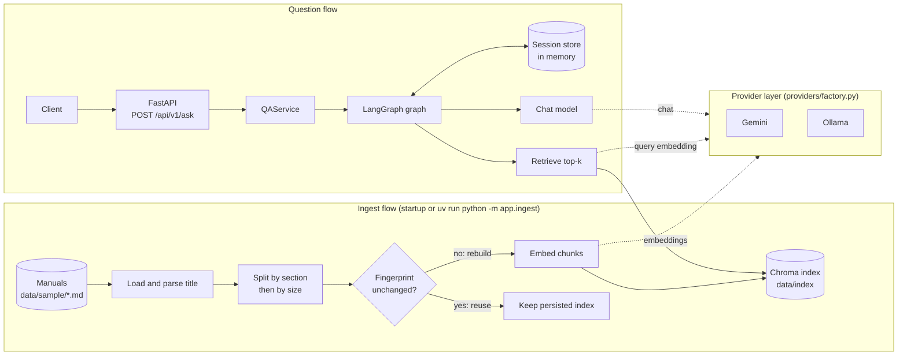
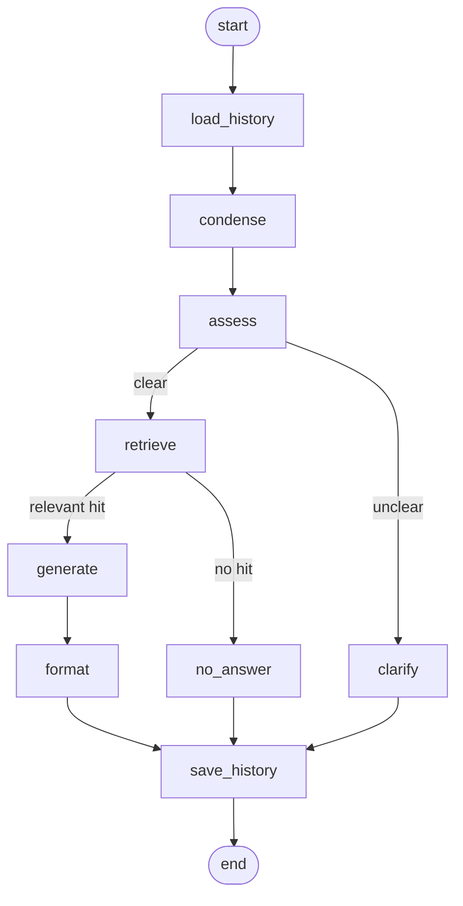

# DocuQuery – RAG backend

DocuQuery is an HTTP API (FastAPI) that answers natural-language questions about the user manuals of household and DIY appliances with retrieval-augmented generation, and returns the sources it used: the product and the manual section. It runs with Google Gemini (primary, cloud) or fully locally with Ollama, switched by environment variables only.

## Contents

- [Problem and features](#problem-and-features)
- [Quick start](#quick-start)
- [Project structure](#project-structure)
- [Architecture and design decisions](#architecture-and-design-decisions)
- [Question flow](#question-flow)
- [Data preparation](#data-preparation)
- [Sample data](#sample-data)
- [Indexing](#indexing)
- [Ask endpoint](#ask-endpoint)
- [Health endpoints](#health-endpoints)
- [Conversation history](#conversation-history)
- [Model providers](#model-providers)
- [Primary model (Gemini)](#primary-model-gemini)
- [Local alternative (Ollama)](#local-alternative-ollama)
- [Docker setup](#docker-setup)
- [Concurrency and scaling](#concurrency-and-scaling)
- [Tests](#tests)
- [Known limitations and next steps](#known-limitations-and-next-steps)

## Problem and features

A large webshop sells household and DIY appliances, and every product comes with a user manual. These manuals run to many pages, so customers and customer support agents struggle to find specific answers in them. The target users are customers before a purchase, who compare product features and technical data; customers after a purchase, who turn to the manual with questions about usage, maintenance or troubleshooting; and customer support agents, who want to give accurate answers quickly. DocuQuery is an HTTP API that an AI assistant on the webshop's pages can be built on, helping customers get answers to their questions. Users ask their question in natural language, for example: "How often should I descale the KV-200 coffee maker?" The system answers from the relevant passages of the manuals rather than from a manual as a whole. The answer also names its source, meaning the product and the manual section. This lets users verify the answer without having to read the entire document.

### Features

- **Q&A with sources:** `POST /api/v1/ask` retrieves the relevant manual chunks and answers from them only; every answer lists the product, section, chunk ID, relevance score and a snippet of each source it used.
- **Clarifying questions:** a well-formed but unclear question gets a clarifying question from the LLM (`status: clarification_needed`) instead of a guess or an error.
- **No-answer handling:** when no chunk is relevant enough, a fixed "no relevant information" reply is returned without calling the model (`status: no_answer`).
- **Session history:** follow-up questions are interpreted with the earlier conversation, kept in memory per `session_key`.
- **Product filter:** the optional `product_id` restricts the search to one product's manual.
- **Health endpoints:** `GET /health` (liveness) and `GET /health/ready` (indexing state, optional LLM check).
- **Switchable providers:** Gemini or Ollama for the chat model and for the embeddings, chosen independently in the environment.
- **Startup indexing:** the manuals are loaded, split by section, embedded and persisted at startup (or with `uv run python -m app.ingest`); an unchanged index is reused.
- **Unified errors and logging:** one error body `{"detail", "code", "request_id"}`, structured logs with the request ID and duration.
- **Docker:** a `Dockerfile` and a `docker-compose.yml` for local mode (with Ollama) and cloud mode.
- **Concurrency limit:** model calls run under a per-process limit; an overloaded instance answers `503 SERVER_BUSY` instead of queueing without bound.

### Example questions

- **Usage:** How do I start the espresso program on the KV-200 coffee maker?
- **Maintenance:** How often should I descale the KV-200 coffee maker?
- **Troubleshooting:** Why is the red light flashing on the drill, and what should I do?
- **Technical data:** What are the maximum speed and the power of the impact drill?
- **Safety:** Can I use the chainsaw in the rain, and what protective equipment do I need?

### Capabilities and limits of the prototype

The prototype answers questions about a small set of fictional sample manuals through an API, with in-memory history and an embedded vector store. It is a single-process service that shows the design; it is not meant to carry production traffic. Its limits are listed in "Known limitations and next steps".

## Quick start

Every way to start the application is described here: locally or in Docker, with the free local models (Ollama) or with Gemini. The later sections explain the design and the settings and do not repeat these steps.

### Prerequisites

- Python 3.12 (uv installs it for you if it is missing) and [uv](https://docs.astral.sh/uv/) as the package manager
- For local mode: [Ollama](https://ollama.com/download) (Windows, macOS, Linux); for cloud mode: a Google AI Studio API key
- For the Docker setups: Docker with Compose (Python, uv and Ollama are then not needed on the host)

### 1. Get the code and the configuration

```bash
git clone https://github.com/Regdani/docuquery-rag-backend.git
cd docuquery-rag-backend
uv sync
cp .env.example .env
```

`uv sync` installs the exact versions pinned in `uv.lock` (the Docker setups do not need it). `.env.example` contains names and safe defaults only, no secrets, and is set up for local mode; the rest of the file (paths, chunking, retrieval, timeouts, limits, logging) documents every other setting with its default. `.env` is git-ignored, so `GOOGLE_API_KEY` goes only there.

Then pick one of the four setups below.

### 2a. Local mode (Ollama)

No account, no key, no cost. The first model download needs an internet connection; after that the mode works offline.

1. Pull the two models (a one-time download of about 2.3 GB):

   ```bash
   ollama pull llama3.2:3b
   ollama pull nomic-embed-text
   ```

2. Make sure the Ollama server is running. The desktop installers start it automatically; otherwise run `ollama serve`. It listens on `http://localhost:11434`.
3. Check `.env` (a copy of `.env.example` already contains these values):

   ```env
   LLM_PROVIDER=ollama
   EMBEDDING_PROVIDER=ollama
   EMBEDDING_MODEL=nomic-embed-text
   OLLAMA_BASE_URL=http://localhost:11434
   OLLAMA_CHAT_MODEL=llama3.2:3b
   ```

4. Build the index and start the server:

   ```bash
   uv run python -m app.ingest
   uv run uvicorn app.main:app --reload
   ```

### 2b. Cloud mode (Gemini)

1. Create an API key in Google AI Studio and set these values in `.env`:

   ```env
   LLM_PROVIDER=gemini
   EMBEDDING_PROVIDER=gemini
   EMBEDDING_MODEL=gemini-embedding-001
   GOOGLE_API_KEY=<key>
   GEMINI_CHAT_MODEL=gemini-3.1-flash-lite
   ```

2. Build the index and start the server:

   ```bash
   uv run python -m app.ingest
   uv run uvicorn app.main:app --reload
   ```

### 2c. Docker, local mode (Ollama)

A `.env` file is optional here: the `app` service fills in the Ollama values itself.

```bash
docker compose up --build -d
docker compose exec ollama ollama pull llama3.2:3b
docker compose exec ollama ollama pull nomic-embed-text
docker compose run --rm app python -m app.ingest
docker compose restart app
```

Pull both models before the ingest step and before the first question: without them the startup indexing fails (the API still starts and `/health` answers 200, but `/health/ready` and `/api/v1/ask` return `503`). The models are stored in the `ollama` volume, so the pulls are needed only once. Plan for about 8 GB of RAM and several GB of free disk for the images and models.

### 2d. Docker, cloud mode (Gemini)

Set the Gemini values from "2b. Cloud mode (Gemini)" in `.env`, then start only the cloud service (Ollama is not started):

```bash
docker compose --profile cloud up --build -d app-cloud
docker compose run --rm app-cloud python -m app.ingest
```

`app-cloud` has no provider defaults, so a missing variable stops it at startup. Both app services publish port 8000, so run only one of them at a time. Stop everything with `docker compose --profile cloud down` (add `-v` to delete the index and model volumes).

### 3. Ask a first question

The ingest step is optional in every setup: the server also indexes the manuals in the background at startup, so it is reachable at once, but `/api/v1/ask` answers `503 INDEX_NOT_READY` until http://localhost:8000/health/ready returns `200`. Then ask a question (in another terminal) or use the Swagger UI:

```bash
curl -s -X POST http://localhost:8000/api/v1/ask \
  -H "Content-Type: application/json" \
  -d '{"question": "What are the maximum speed and the power of the DR-450 impact drill?"}'
```

More sample requests are in "Ask endpoint". The local 3B model sometimes answers a clear question with a clarifying question; name the product, rephrase, or use Gemini for better answers.

The API listens on port `8000` by default:

| URL | What it is |
|---|---|
| http://localhost:8000/docs | Swagger UI with request and response examples |
| http://localhost:8000/redoc | ReDoc view of the same API |
| http://localhost:8000/openapi.json | OpenAPI schema |
| http://localhost:8000/health | Liveness check |
| http://localhost:8000/health/ready | Readiness check (indexing state) |
| http://localhost:8000/api/v1/ask | Ask endpoint (`POST`) |

Locally, uvicorn listens on `127.0.0.1:8000`; use `--port <port>` to pick another port. In Docker the container always listens on `8000`, and compose publishes it on the host port `APP_PORT` (default `8000`); with `APP_PORT=8080` in `.env` the API is at http://localhost:8080. Neither mode opens a browser; open the Swagger UI by hand.

## Project structure

```
app/
  main.py              FastAPI app factory and lifespan (indexing task, graph built once)
  ingest.py            CLI: load, chunk, embed, persist the index
  api/
    routes.py          POST /api/v1/ask
    health.py          GET /health and GET /health/ready
    schemas.py         request and response models with examples
    handlers.py        exception handlers
    deps.py            FastAPI dependencies (service and index status from app.state)
  services/
    qa_service.py      QAService: runs the graph for one question (no HTTP, no provider imports)
  memory/
    store.py           InMemorySessionStore (session_key to messages, asyncio.Lock)
  rag/
    graph.py           LangGraph question flow and its nodes
    memory_nodes.py    load_history and save_history nodes
    state.py           per-request graph state
    prompts.py         prompts of the LLM steps
    loader.py          reads the markdown manuals
    chunking.py        splits manuals into section-based chunks with metadata
    indexing.py        index build, fingerprint check and reuse
    index_status.py    indexing state shown by /health/ready
    limiter.py         model-call concurrency limit
  providers/
    factory.py         the only place that selects and imports providers (Gemini, Ollama, Chroma)
    resilience.py      timeout, retry and error translation for provider calls
  core/
    config.py          Settings (all env vars)
    errors.py          ServiceError subclasses and error codes
    logging.py         structured logging setup
data/
  sample/              the fictional sample manuals (markdown)
  index/               the generated Chroma index (git-ignored)
tests/
  fakes.py             test doubles (fake chat model, embeddings, vector store)
  unit/  api/          offline tests
  integration/         tests against real Ollama or Gemini
scripts/
  load_probe.py        parallel request probe for the concurrency limit
.github/workflows/
  ci.yml               lint, format check, type check and offline tests
Dockerfile             application image
docker-compose.yml     app + Ollama (local mode) and app-cloud (Gemini)
pyproject.toml         project metadata and dependencies
uv.lock                pinned dependency versions
.env.example           configuration names and safe defaults (no secrets)
```

## Architecture and design decisions

### Overview



The steps inside the graph are shown in "Question flow". Chat and embeddings each pick Gemini or Ollama independently from the environment; nothing outside the provider layer knows which one is in use.

### Layers

| Layer | Directory | Responsibility |
|---|---|---|
| API | `app/api/` | HTTP routes, request and response schemas, exception handlers, request ID. No RAG logic. |
| Service | `app/services/` | `QAService`: the application logic that runs one question through the graph. No HTTP, no provider imports. |
| RAG | `app/rag/` | The LangGraph graph, prompts, chunking, indexing, retrieval and the concurrency limiter. Depends on langchain-core abstractions only. |
| Memory | `app/memory/` | The in-memory session store, the only shared mutable state. |
| Providers | `app/providers/` | Creates the chat model, the embeddings and the vector store for the configured provider; timeouts, retries and error translation. |
| Core | `app/core/` | Settings, error classes, logging. |

Rules that keep the layers apart:

- **Provider isolation:** provider packages (`langchain_google_genai`, `langchain_ollama`, `langchain_chroma`, `chromadb`) are imported only inside `app/providers/`, lazily in the create function of the provider. Everything else uses the langchain-core abstractions (`BaseChatModel`, `Embeddings`, `VectorStore`), so a provider can be replaced without touching the graph.
- **Selection by config only:** `LLM_PROVIDER`, `EMBEDDING_PROVIDER` and `EMBEDDING_MODEL` choose the providers. The only provider branching is in `providers/factory.py`; a missing or unknown value stops startup with an error naming the variable, never a silent fallback.
- **Fakes only in tests:** there is no mock provider. The test doubles live in `tests/fakes.py` and are injected through FastAPI dependency overrides or passed to the graph builder; `app/` contains real implementations only.
- **Built once, read-only:** providers, the index and the compiled graph are created at startup and not modified afterwards; per-request data lives in the graph state.

### Design trade-offs

Each item gives the choice, the alternative and the reason. Defaults are those of `app/core/config.py` and `.env.example`.

- **Embedded Chroma instead of a vector-store server.** Chroma runs inside the process and is persisted to `./data/index`. A server store (Chroma server mode, pgvector, Qdrant) could be shared between instances, but it adds a service to run and operate. For seven manuals and a single process the embedded store keeps the setup to one command. The cost: instances cannot share one index (see "Known limitations and next steps").
- **Section-based chunking with `CHUNK_SIZE=800` and `CHUNK_OVERLAP=100`.** Manuals are split along their `## ` sections first, and only then by size. The alternative is a fixed-size splitter over the whole text, which is simpler but cuts across sections and mixes products. Section-based chunks keep one chunk inside one part of one manual, which gives a clean source (product and section) for every answer. 800 characters fit a typical short section in one or two chunks and stay small enough for a precise match; the 100-character overlap keeps a sentence on a boundary readable in both chunks. Larger chunks give more context per hit but less precise retrieval and more tokens per question.
- **`RETRIEVAL_TOP_K=4` and `RETRIEVAL_RELEVANCE_THRESHOLD=0.3`.** The top 4 chunks are enough for a question about one topic and keep the prompt short; a higher value adds noise and cost. Chunks below the 0.3 relevance score are not used, and if none reaches it the application answers "no relevant information" without calling the model. The alternative is to always pass the top chunks to the model, which makes it more likely to answer questions the manuals do not cover. The threshold is a reasoned default for the default embeddings, not a tuned value; another embedding model may need another one.
- **Startup indexing in the background instead of an upload API or a separate ingest job.** The server starts at once and reports the indexing state on `/health/ready`; the same pipeline is available as `uv run python -m app.ingest`. An upload API would need authentication and storage, and a separate job would need orchestration. The cost: with several instances each one indexes on its own, and the first start is slow because every chunk is embedded.
- **In-memory history instead of a store.** History is a dict keyed by `session_key` behind an `asyncio.Lock`. It needs no infrastructure and keeps the interface simple, but it is lost on restart and not shared between instances. Redis with a TTL behind the same get/save interface is the next step.
- **An LLM clarifying question instead of always answering.** A vague question such as "My machine doesn't work." gets one targeted question back. Answering anyway would produce a guess or a generic reply and often cite the wrong product. The cost: one extra LLM call per question, and a small local model sometimes asks for clarification when the question was clear enough.
- **Limiting model calls per process instead of unbounded parallelism.** `MAX_CONCURRENT_REQUESTS=8` protects the provider quota and, locally, the machine; an overloaded instance fails fast with `503 SERVER_BUSY`. The alternative is an unbounded or queued design, which hides overload as latency.

## Question flow

Every question runs through a LangGraph graph that is compiled once at startup. The state (question, history, hits, answer, sources, status) is created per request, so requests share nothing except the session store.



- `load_history`: loads the stored messages for the `session_key` (empty for a new conversation).
- `condense`: with history, one LLM call rewrites a follow-up into a standalone question; without history it makes no LLM call.
- `assess`: one LLM call decides whether the question is clear enough to search. If the answer cannot be parsed, the question is treated as clear so retrieval still runs.
- `clarify`: the LLM asks one targeted clarifying question (`status: clarification_needed`); retrieval and generation are skipped.
- `retrieve`: fetches the top `RETRIEVAL_TOP_K` chunks (server setting, 1 to 20; an out-of-range value stops startup) with relevance scores (0 to 1). If at least one score reaches `RETRIEVAL_RELEVANCE_THRESHOLD` the flow continues with `generate`, otherwise with `no_answer`.
- `generate`: answers from the chunks at or above the threshold only, and says so when the context does not contain the answer.
- `no_answer`: a fixed "no relevant information" reply (`status: no_answer`, no sources, no LLM call).
- `format`: sets `status: answered` and the sources (product ID and name, section, source file, chunk ID, relevance score, snippet) of the chunks used, and logs them.
- `save_history`: appends the question and the reply (answer or clarifying question) to the session.

Provider errors (timeout, unavailable, rate limited) leave the graph unchanged as domain errors and nothing is saved to the history; unexpected errors are wrapped in a generic pipeline error (`RAG_PIPELINE_ERROR`, 502) without internal details.

## Data preparation

By default the application uses the fictional sample manuals in `data/sample/` (see "Sample data"); no preparation is needed. The index is built automatically at startup or by the ingest command shown in "Quick start" (see "Indexing").

**Using your own manuals:** put markdown files in a directory and point `DATA_DIR` at it in `.env` (for example `DATA_DIR=./data/my-manuals`). Each file must start with a title heading of the form `# <ID> – <name>` (for example `# KV-200 – Espresso Coffee Maker`, with an en dash), followed by `## ` sections (`## Safety`, `## Maintenance`, ...). Files without the title are logged and skipped. A changed file, embedding model or chunk setting is detected by the fingerprint, and the index is rebuilt on the next start or ingest run.

## Sample data

Real manufacturer manuals are copyrighted, so the repository ships its own short manuals in `data/sample/`. All products and brands in them (KV-200, KV-300, DR-450, CS-350, RV-700, WM-800, AP-120) are fictional, and the documents contain no confidential or real manufacturer content. Each manual is a markdown file with the same sections: Safety, Setup, Usage, Maintenance, Troubleshooting and Technical data. The set includes two similar coffee makers (KV-200 and KV-300) with different descaling intervals, so retrieval has to pick the right product.

### Questions the documents can answer

- How do I start the espresso program on the KV-200 coffee maker? (`kv-200-espresso-coffee-maker.md`, Usage)
- How often should I descale the KV-200 coffee maker? (`kv-200-espresso-coffee-maker.md`, Maintenance: every 60 days or 200 brew cycles. The KV-300 drip coffee maker differs: every 30 days.)
- Why is the red light flashing on the DR-450 drill, and what should I do? (`dr-450-cordless-impact-drill.md`, Troubleshooting)
- What are the maximum speed and the power of the DR-450 impact drill? (`dr-450-cordless-impact-drill.md`, Technical data: 2000 rpm, 600 W)
- Can I use the CS-350 chainsaw in the rain, and what protective equipment do I need? (`cs-350-electric-chainsaw.md`, Safety)

### Questions the documents cannot answer

- How much does the KV-200 coffee maker cost?
- Is the WM-800 washing machine in stock?
- How do I descale the KV-500 coffee maker? (this product is not in the set)
- Which smartphones can control the RV-700 robot vacuum? (no manual states this)

## Indexing

There is no upload API. When the application starts, it loads the manuals from `DATA_DIR` (default `data/sample/`), splits them, embeds the chunks and writes them to the vector store. Indexing runs in a background task, so the server starts immediately. Until indexing has succeeded, endpoints that need the index respond with `503` and the code `INDEX_NOT_READY`. If the data directory is missing or empty, the state becomes `failed` with a clear message, the app still starts and the same `503` is returned. The state (`indexing`, `ready` or `failed`, document and chunk counts, embedding model, timestamp, error) is kept on `app.state.index_status`.

The ingest command in "Quick start" runs the same pipeline from the command line. It prints a summary and exits with 0 on success and 1 (with the error message) when indexing failed.

Settings: `DATA_DIR`, `INDEX_DIR`, `CHROMA_COLLECTION`, `CHUNK_SIZE` and `CHUNK_OVERLAP` (see `.env.example`).

### Chunking

Each manual is split along its `## ` sections, and every section is split on its own with a recursive character splitter (`CHUNK_SIZE`, `CHUNK_OVERLAP`). A section is a Markdown level-2 heading (`## Maintenance`) and runs until the next one; the heading text becomes the section title, and any text before the first `##` is the introduction. Only exactly two `#` start a section: the `#` title and `###` sub-headings stay inside the surrounding text. Text is never merged across sections, so a chunk answers from exactly one part of one manual (for example "Maintenance" of the KV-200). Every chunk carries metadata: source file, product ID and name (parsed from the `# <ID> – <name>` title) and section title, plus a stable, unique chunk ID. These are the fields the answer later reports as its sources. The chunk text starts with a short `<ID> <name> - <section>` line so similar products (KV-200 and KV-300) stay distinguishable. Files without the title heading are logged and skipped.

### Vector store

Chroma runs embedded and is persisted to `INDEX_DIR` (`./data/index`). It needs no extra service, keeps the setup to a single process and is enough for a manual set of this size. The collection name is `CHROMA_COLLECTION` plus the sanitized embedding model name, so indexes built with different embedding models never mix.

### Startup indexing trade-offs

- A fingerprint (SHA-256 over the sorted file names and contents, the embedding model, the chunk size and the overlap) is stored next to the index. If it is unchanged and all chunks are present, the persisted index is reused and no embedding calls are made. Otherwise the old chunks are deleted and the index is rebuilt without duplicates.
- A first start (or a start after a change) is slower because every chunk is embedded; later starts are fast.
- With several instances, each one indexes on its own (there is no coordination between instances), which costs duplicate embedding work. A shared index built once by a separate job is the next step.

## Ask endpoint

`POST /api/v1/ask` runs the question flow and returns the answer with the chunks it used. The route only calls `QAService`, which invokes the compiled graph; the graph and the service are built once in the application lifespan and live on `app.state`. Swagger UI (`/docs`) shows request examples (successful question, follow-up, clarification, product-scoped question) and response examples for every status and error.

Request body:

| Field | Required | Description |
|---|---|---|
| `question` | yes | The question. Whitespace is trimmed; a blank question is a `422`. |
| `session_key` | no | 8-64 characters (letters, digits, `-`, `_`) linking follow-up questions. Without it (or with an empty string) a new conversation starts and the response returns a generated key. |
| `product_id` | no | Restricts retrieval to one product's manual (for example `KV-200`). Applied as a metadata filter on the shared index; without it, retrieval searches all manuals. An empty string counts as absent. |

Response body: `answer`, `status`, `sources`, `session_key` (the request's key or a newly generated one) and `request_id`. Each source has `product_id`, `product_name`, `section`, `chunk_id`, `score` (0 to 1) and a `snippet` capped at `SNIPPET_MAX_CHARS`.

| `status` | Meaning | `sources` |
|---|---|---|
| `answered` | A grounded answer from relevant chunks | the chunks used |
| `clarification_needed` | The question is unclear; `answer` is a clarifying question | empty |
| `no_answer` | No chunk reached the relevance threshold | empty |

**Unknown product:** a `product_id` that is not in the index returns `404` with the code `PRODUCT_NOT_FOUND` (not `422`, because the request is well formed and the resource it names does not exist). The known IDs come from the index itself; matching ignores case.

**Check order:** the request body is validated first (`422`), then the index guard runs (`503 INDEX_NOT_READY`). A malformed request is wrong whatever the index state, so while indexing is running or has failed an invalid request still gets a `422` and a valid one gets the `503`.

**Invalid vs unclear:** a technically invalid request (missing or wrong-typed field, malformed JSON, blank question, question longer than `MAX_QUESTION_LENGTH`, bad `session_key`) is a `422`. A well-formed but unclear question (for example "My machine doesn't work.") is not an error: it returns `200` with `status: clarification_needed` and the clarifying question as `answer`. With a `session_key` the next question is interpreted together with the stored history.

**Errors** always use the body `{"detail", "code", "request_id"}`; `detail` is a readable string and never contains a stack trace or internal exception text. A `422` adds `errors`, a list of `{"field", "message", "type"}` items; the submitted values are not echoed. Example:

```json
{
  "detail": "Invalid request: question: String should have at least 1 character",
  "code": "VALIDATION_ERROR",
  "request_id": "3f2b8c1e9d7a4e6f",
  "errors": [
    {"field": "question", "message": "String should have at least 1 character", "type": "string_too_short"}
  ]
}
```

| Status | `code` | When |
|---|---|---|
| 404 | `PRODUCT_NOT_FOUND` | `product_id` is not in the index |
| 404 / 405 / other | `NOT_FOUND`, `METHOD_NOT_ALLOWED`, ... | Unknown route, wrong method (same unified body) |
| 422 | `VALIDATION_ERROR` | Invalid request body (see above) |
| 502 | `LLM_UNAVAILABLE` | Provider unreachable or answering with a 5xx error |
| 502 | `LLM_EMPTY_RESPONSE` | The model returned an empty answer |
| 502 | `RAG_PIPELINE_ERROR` | Unexpected failure inside the question flow; generic message. It has its own code so a bug is not reported as the model being unreachable |
| 503 | `INDEX_NOT_READY` | Indexing is running or failed |
| 503 | `LLM_RATE_LIMITED` | Provider still rate limits after the bounded retries; carries a `Retry-After` header |
| 503 | `SERVER_BUSY` | No model slot became free within `CONCURRENCY_WAIT_SECONDS`; carries a `Retry-After` header (see "Concurrency and scaling") |
| 504 | `LLM_TIMEOUT` | Provider did not answer within the timeout |
| 500 | `INTERNAL_ERROR` | Any other unhandled exception; generic message |

`Retry-After` is an integer number of seconds. For `LLM_RATE_LIMITED` it is taken from the provider's `Retry-After` header when that is a number; otherwise `RATE_LIMIT_RETRY_AFTER_SECONDS` (default 5) is used. For `SERVER_BUSY` it is `CONCURRENCY_WAIT_SECONDS` rounded up (at least 1).

**Logging:** the application's logs go to stdout as `<time> <LEVEL> <logger> <message>` lines, next to uvicorn's own output. Read them in the terminal that runs uvicorn, or with `docker compose logs -f app` under Docker. `LOG_LEVEL` (`DEBUG`, `INFO`, `WARNING`, `ERROR` or `CRITICAL`, default `INFO`; any other value stops startup) sets the level. Every request is logged at INFO with method, path, status, duration in milliseconds and `request_id`; health probes are logged at DEBUG so they do not flood the log. Every `4xx` is logged at WARNING with the error code, the affected field names (for `422`) and the `request_id`; the request body is not logged. Every `5xx` and every unexpected exception is logged at ERROR with the stack trace, in the log only. `clarification_needed` and `no_answer` are normal outcomes and are logged at INFO.

**Request ID:** the `X-Request-ID` header is used when the client sends one, otherwise an ID is generated. It is returned in the `X-Request-ID` response header and in `request_id` of success and error bodies, and appears in the log lines of the request together with each source's product, section, chunk ID and score. The question is logged truncated to `LOG_QUESTION_MAX_CHARS`.

Sample requests:

```bash
# A question
curl -s -X POST http://localhost:8000/api/v1/ask \
  -H "Content-Type: application/json" \
  -d '{"question": "How often should I descale the KV-200 coffee maker?"}'

# A follow-up: send the session_key returned by the previous answer (or your own key)
curl -s -X POST http://localhost:8000/api/v1/ask \
  -H "Content-Type: application/json" \
  -d '{"question": "And the KV-300?", "session_key": "demo-session-01"}'

# Restricted to one product
curl -s -X POST http://localhost:8000/api/v1/ask \
  -H "Content-Type: application/json" \
  -d '{"question": "How do I descale it?", "product_id": "KV-200"}'

# Unclear question: 200 with status "clarification_needed" and a clarifying question
curl -s -X POST http://localhost:8000/api/v1/ask   -H "Content-Type: application/json"   -d '{"question": "How do I clean it?"}'

# Empty question: 422 with the unified error body (shown above)
curl -s -X POST http://localhost:8000/api/v1/ask   -H "Content-Type: application/json"   -d '{"question": ""}'
```

Health requests are in the next section.

## Health endpoints

Both endpoints are at the root, outside `/api/v1`, are listed in Swagger UI with an example for every state, and are not affected by the index guard of the ask endpoint. Every response carries `X-Request-ID`.

**`GET /health`** (liveness) returns `200` with `{"status": "ok"}` whenever the process is serving, whatever the indexing state. It touches neither the index nor any provider.

```bash
curl -s http://localhost:8000/health
```

**`GET /health/ready`** (readiness) reports the startup indexing state:

| Field | Meaning |
|---|---|
| `state` | `indexing`, `ready` or `failed` |
| `document_count`, `chunk_count` | Size of the index |
| `embedding_model` | Embedding model the index was built with |
| `last_indexed_at` | UTC time (ISO 8601) of the last indexing status change |
| `error` | Reason when `failed`, otherwise `null` |
| `llm` | Only with `check_llm=true` (see below) |

| Condition | Status code |
|---|---|
| `state` is `ready` and `chunk_count >= 1` | `200` |
| `indexing`, `failed`, or `ready` with zero chunks | `503`, with the same body so clients can read the state |

```bash
curl -s -i http://localhost:8000/health/ready
```

**Optional LLM check:** `GET /health/ready?check_llm=true` also sends one minimal request to the configured chat model and reports `"llm": {"status": "ok" | "unreachable" | "timeout"}`. It is off by default because it costs latency and, on cloud providers, a few tokens. It is informational: it never changes the status code or `state`, and a failure is logged at WARNING without exposing exception details. The call is bounded by `HEALTH_LLM_TIMEOUT_SECONDS` (default 5).

```bash
curl -s -i "http://localhost:8000/health/ready?check_llm=true"
```

## Conversation history

Every answer returns a `session_key`; sending it with the next question continues the conversation.

- **How it works:** history is a dict of `session_key` to messages, guarded by an `asyncio.Lock`. The history is loaded before the question is processed and saved afterwards (question plus answer). Clarifying questions asked by the assistant are remembered too, so the user's next message is read in that context.
- **Key handling:** without a `session_key` (or with an empty one) the request starts a new conversation and the server generates a random key (32 hex characters), stores the question and answer under it and returns it in the response. With a `session_key` (8-64 characters: letters, digits, `-`, `_`) the stored history is used and extended, and the same key is returned; an unknown key starts a new conversation under that key. A request without a key never sees earlier history.
- **Setting:** `HISTORY_MAX_MESSAGES` (default 20, minimum 1) is the number of most recent messages kept per session; older messages are dropped.
- **Limits:** history lives in process memory only and is lost on restart. Several instances do not share it, so a follow-up routed to another instance starts empty. It is not a LangGraph checkpointer, and the key is not authentication: anyone who knows a key can read and extend that session. The number of sessions is not bounded, and since every request without a key creates one, memory grows with the request count until the restart.
- **Production alternative:** store the transcripts in Redis (with a TTL) or PostgreSQL, behind the same get/save interface, so that all instances share them and they survive restarts.

## Model providers

Three variables choose the models, and all three are required:

| Variable | Values | Meaning |
|---|---|---|
| `LLM_PROVIDER` | `gemini`, `ollama` | Provider of the chat model |
| `EMBEDDING_PROVIDER` | `gemini`, `ollama` | Provider of the embeddings, chosen independently of `LLM_PROVIDER` |
| `EMBEDDING_MODEL` | model name | Embedding model of `EMBEDDING_PROVIDER`: `gemini-embedding-001` (Gemini) or `nomic-embed-text` (Ollama) |

There are no defaults and no fallbacks: the embeddings never follow `LLM_PROVIDER`, and a missing or unknown value stops the application (and the ingest command) at startup with an error that names the variable. Because chat and embeddings are always configured separately, a mixed setup changes only these lines. The chat model names stay provider-specific (`GEMINI_CHAT_MODEL`, `OLLAMA_CHAT_MODEL`). Every external call uses `LLM_TIMEOUT_SECONDS` / `EMBEDDING_TIMEOUT_SECONDS` and `MAX_RETRIES`.

For Gemini, vendor failures are translated into three domain errors: a timeout (`LLM_TIMEOUT`, HTTP 504), an unreachable provider or a 5xx answer (`LLM_UNAVAILABLE`, 502) and rate limiting (`LLM_RATE_LIMITED`, 503 with a `Retry-After` header). An HTTP 429 is retried at most `MAX_RETRIES` times with an exponential backoff starting at `RETRY_BACKOFF_SECONDS` before the rate-limit error is raised. This sits on top of the vendor client's own retries, so the worst case is more calls than `MAX_RETRIES` alone suggests. Error messages never contain keys or vendor messages.

Ollama runs locally, so there are no rate limits and no retries. Its failures use the same domain errors (a timeout is `LLM_TIMEOUT`, 504; an unreachable server or a model that is not pulled is `LLM_UNAVAILABLE`, 502), and the message names the base URL and, for a missing model, the `ollama pull <model>` command.

## Primary model (Gemini)

Gemini is the primary model: a managed API with stronger answers than a small local model, no hardware to run, and one key for both the chat model and the embeddings. The same key works on the free tier for trying the project and on the paid tier, which lifts the rate limits for real traffic. The `.env` values are listed in "Quick start"; switching between Gemini and Ollama is done by these environment variables only, no code change is needed.

Besides the three provider variables only `GOOGLE_API_KEY` is required; `GEMINI_CHAT_MODEL` has a default. `gemini-3.1-flash-lite` is the small, low-latency, low-cost model, which is enough for answering from a few retrieved manual chunks and stays within free-tier rate limits. `gemini-embedding-001` is Google's general-purpose text embedding model. The free tier is rate limited, so a first indexing run may hit 429 answers; they are retried with backoff.

To confirm that the embedding model is available for your key, run the key-gated integration test, which calls `embed_query` with the configured model:

```bash
GOOGLE_API_KEY=<key> uv run pytest -m integration -k gemini
```

You can also list the models your key can use with `GET https://generativelanguage.googleapis.com/v1beta/models?key=<key>`. If the embedding model is not available to you, set `EMBEDDING_MODEL` to another model from that list.

## Local alternative (Ollama)

Ollama runs the chat model and the embeddings on your own machine: no account, no key, no cost. `.env.example` is set up for this mode, and switching to or from it is done by environment variables only; the setup steps are in "Quick start".

No key variable is needed. The application reaches Ollama through `OLLAMA_BASE_URL`: `http://localhost:11434` when both run as local processes, and `http://ollama:11434` in Docker Compose, where Ollama runs in its own container (see "Docker setup"). The index collection for this setup is `manuals-ollama-nomic-embed-text`. Local mode is verified at the level of the chat model, the embeddings and the retriever by the integration test below; `POST /api/v1/ask` needs a running Ollama to answer.

If Ollama is not running, ingest prints `Ollama is not reachable at <base url>. Start it with 'ollama serve' or check OLLAMA_BASE_URL` and exits with 1; if a model is missing, the message names it and says `ollama pull <model>`. The application itself still starts, and endpoints that need the index answer `503`.

Integration test against the real server (indexes one sample manual into a temporary directory, retrieves a relevant chunk and makes one chat call):

```bash
uv run pytest -m integration -k ollama
```

It is skipped, not failed, when Ollama is unreachable or a configured model is not pulled.

### Hardware, speed and quality (estimates)

These figures are rough estimates based on the public model sizes.

- **Memory:** `llama3.2:3b` is about a 2 GB download and needs roughly 3 to 4 GB of free RAM (or VRAM) while loaded; `nomic-embed-text` is about 270 MB and needs well under 1 GB. Plan for about 8 GB of RAM in total, with room for the operating system and the application.
- **CPU or GPU:** both models run on a CPU only. A GPU with 4 GB or more of VRAM (or Apple Silicon) is considerably faster but not required.
- **Speed on a CPU:** expect a few seconds before the first token and roughly 5 to 20 generated tokens per second on a recent laptop CPU, so a short answer takes several seconds to half a minute. Indexing the seven sample manuals should take on the order of tens of seconds to a few minutes on a CPU the first time; later starts reuse the persisted index. Raise `LLM_TIMEOUT_SECONDS` on slow machines, and note that the first request after a pause also loads the model into memory.
- **Quality limits:** a 3B model gives noticeably weaker answers than the cloud models. It can ignore the retrieved context or make up details (hallucination), follows instructions less reliably, handles long context poorly and is clearly weaker in languages other than English. The sample manuals are in English, which is the best case.
- **Concurrency:** a single local server processes few requests at a time; parallel questions queue up. This mode is meant for development, demos and offline use.

### Mixed setup: cloud chat with local embeddings

Chat answers can come from Gemini while the embeddings stay local and free:

```env
LLM_PROVIDER=gemini
EMBEDDING_PROVIDER=ollama
EMBEDDING_MODEL=nomic-embed-text
GOOGLE_API_KEY=<key>
```

Run `ollama pull nomic-embed-text` first. The index collection name contains the embedding model, so changing the embeddings builds a new index instead of mixing vectors: this setup uses `manuals-ollama-nomic-embed-text`, while `EMBEDDING_PROVIDER=gemini` with `EMBEDDING_MODEL=gemini-embedding-001` uses `manuals-gemini-gemini-embedding-001`. The old collection stays in `INDEX_DIR` unused.

## Docker setup

The `Dockerfile` builds a `python:3.12-slim` image that installs the locked dependencies with uv (`uv sync --frozen --no-dev`), runs as the non-root user `appuser` and starts `uvicorn app.main:app` on `0.0.0.0:8000`. The sample manuals are baked into the image; the index is not. `docker-compose.yml` defines:

- `app`: the API with Ollama as its provider (local mode); `OLLAMA_BASE_URL` is set to `http://ollama:11434` by compose, overriding `.env`. As the local-mode service it fills in `LLM_PROVIDER=ollama`, `EMBEDDING_PROVIDER=ollama` and `EMBEDDING_MODEL=nomic-embed-text` when `.env` does not set them, so it starts without a `.env`; values from `.env` take precedence.
- `ollama`: the Ollama server (`ollama/ollama`), with the models stored in the named volume `ollama`.
- `app-cloud`: the same image without Ollama, in the `cloud` profile, for Gemini.

The index lives in the named volume `index` (mounted at `INDEX_DIR=/app/data/index`), so it survives restarts and is shared by the `app` and the ingest command. The ingest command only pre-builds the index in the shared volume (the app also indexes at startup), and restarting the app makes a running instance pick it up. The health check of the API container calls `GET /health`. The start commands are in "Quick start".

To use an NVIDIA GPU, add a `deploy.resources.reservations.devices` entry to the `ollama` service (requires the NVIDIA Container Toolkit); this is optional and not configured here.

## Concurrency and scaling

Every statement below is labelled **implemented** (it is in the code of this repository) or **next step** (it is not built). The service runs as one process with one event loop; scaling beyond that is described, not implemented.

| Variable | Default | Meaning |
|---|---|---|
| `MAX_CONCURRENT_REQUESTS` | `8` | Most model calls (chat and query embedding) running at once in one process; must be at least 1, anything else stops startup |
| `CONCURRENCY_WAIT_SECONDS` | `5` | How long a call waits for a free slot before the request fails with `503 SERVER_BUSY`; must be greater than 0 |

### Request isolation

- **Implemented:** the compiled graph, the providers, the vector store and the limiter are created once at startup and are not modified afterwards. All per-request data lives in the graph state (a new dict for every call of `QAService.ask`) and in local variables, so two requests cannot see each other's question, hits or answer.
- **Implemented:** the only shared mutable object is `InMemorySessionStore`, a dict keyed by `session_key` and guarded by an `asyncio.Lock`. A request without a key gets a fresh random key and therefore its own history.
- **Implemented:** errors are per request: a failed model call raises a domain error for that request only and releases its model slot, so a failure or a timeout never blocks later requests.

### Parallel execution

- **Implemented:** the ask route, `QAService`, every graph node and the health endpoints are `async`. Chat calls use the clients' async API (`ainvoke`). The vector search, which runs the sync query embedding and the Chroma lookup, runs in a worker thread with `asyncio.to_thread`, and so does the startup indexing, so a slow search does not stall other requests (covered by a test with a blocking search and a ticker task).
- **Implemented:** the model-call limit is an `asyncio.Semaphore` of `MAX_CONCURRENT_REQUESTS` slots, created once and shared by all requests (`app/rag/limiter.py`). The slot is taken around each chat call and around the retrieval step, not around the whole request, so cheap work (history, formatting) never waits for a slot. A request makes two to four such calls in sequence (condense when there is history, assess, retrieve, then generate or clarify), so under load it can wait for a slot more than once.
- **Implemented:** retries happen while the slot is held. The bounded 429 retry (`MAX_RETRIES`, exponential backoff from `RETRY_BACKOFF_SECONDS`) sits inside the call, so a rate-limited call keeps its slot during the backoff. This keeps the number of calls against the provider bounded by the slot count; the cost is that a long backoff reduces the free slots.
- **Implemented:** a call that cannot get a slot within `CONCURRENCY_WAIT_SECONDS` fails with `503 SERVER_BUSY`, a `Retry-After` header and the unified error body. It is logged at WARNING with the `request_id` and no stack trace. The response arrives after about the wait limit, not after the model timeout.
- **Next step:** run several uvicorn workers or instances (see below); queue requests instead of rejecting them; stream answers.

### Resource limits

- **Implemented:** every external call has a timeout from Settings: the chat client (`LLM_TIMEOUT_SECONDS`), the embeddings client (`EMBEDDING_TIMEOUT_SECONDS`) and the optional LLM health check (`HEALTH_LLM_TIMEOUT_SECONDS`). The model-slot wait is bounded by `CONCURRENCY_WAIT_SECONDS`, the question length by `MAX_QUESTION_LENGTH`, the retrieved chunks by `RETRIEVAL_TOP_K` and the history per session by `HISTORY_MAX_MESSAGES`.
- **Implemented:** retries are bounded (`MAX_RETRIES`, only for HTTP 429 and only for Gemini; Ollama is not retried).
- **Implemented:** the limit is per process. With Ollama the limit protects a single machine: a local model on a CPU serves roughly one generation at a time, so a small value (1 to 2) gives lower latency per request than a large one.
- **Not bounded (known limit):** the number of sessions in memory, and the default worker thread pool of the event loop used by `asyncio.to_thread`. Requests that wait for a slot are held as open connections.
- **Next step:** rate limiting per client or per `session_key`, a bound and an expiry for sessions, a limit on the number of waiting requests.

### Multiple application instances

- **Implemented (current behaviour):** nothing is shared between processes. Each instance has its own model-slot limit and its own session history, and builds its own index at startup.
- **Session history:** it is in memory, lost on restart and not shared, so a follow-up sent to another instance starts with an empty history. **Next step:** keep the history in Redis (with a TTL) behind the same get/save interface. **Interim solution (deployment only):** sticky sessions, routing by `session_key` (for example hash-based routing at the load balancer) so that a conversation always reaches the same instance; a restart still loses it.
- **Startup indexing:** every instance builds the index at startup and writes `./data/index` (embedded Chroma). Instances sharing one directory would write to it concurrently, and instances with separate directories repeat the embedding work. **Next step:** a separate ingest job that builds the index once, and a shared vector store (Chroma in server mode or another server-based store) that the instances only read.
- **Next step:** a shared limit across instances (for example a token bucket in Redis) if the provider's rate limit is per API key; until then, size `MAX_CONCURRENT_REQUESTS` per instance so that instances times slots stays under the provider's limit.

### Bottlenecks, metrics and roadmap

- **Bottleneck 1, the model.** Chat latency dominates a request (seconds on Gemini, several seconds to tens of seconds for a small local model on a CPU). The slot limit and the timeouts bound it; they do not make it faster.
- **Bottleneck 2, one process.** Python code outside the model calls shares one event loop, and the embedded Chroma index is opened by one process.
- **Bottleneck 3, the provider limits.** Gemini returns 429 when the quota is exceeded; a local Ollama is limited by the machine's CPU, GPU and memory.
- **Implemented:** logs only. Each request logs its status and duration with the `request_id`, and each error logs its `code`.
- **Next step, metrics to collect:** LLM latency (p50, p95), slot wait time and the number of requests waiting for a slot, error rate by `code` (`SERVER_BUSY`, `LLM_TIMEOUT`, `LLM_RATE_LIMITED`, ...), token usage per request (cost), retrieval latency, and the share of `no_answer` and `clarification_needed` answers. They would be exported through a metrics endpoint (for example Prometheus format).
- **Next step, roadmap in this order:** (1) the metrics above, to see the real bottleneck; (2) session history in Redis; (3) a separate ingest job and a shared or server-mode vector store; (4) several instances behind a load balancer, sticky by `session_key` until the history is shared; (5) per-client rate limiting; (6) a shared limit across instances and a bounded wait queue; (7) streaming answers.

### Load probe

`scripts/load_probe.py` sends a number of questions in parallel (asyncio and httpx) and prints the status counts and latencies:

```bash
uv run python scripts/load_probe.py --url http://localhost:8000 --concurrency 20
```

Measured result (implemented, and run once): the application with fake providers where every model call takes 0.5 s, `MAX_CONCURRENT_REQUESTS=4` and `CONCURRENCY_WAIT_SECONDS=1`, on a development laptop. This shows the limiter, not the speed of a real model.

| Concurrency | Total time | Status counts | Latency (min / median / p95 / max) |
|---|---|---|---|
| 2 | 1.35 s | `200`: 2 | 1.30 / 1.32 / 1.35 / 1.35 s |
| 20 | 2.43 s | `200`: 8, `503 SERVER_BUSY`: 12 | 1.35 / 1.35 / 2.43 / 2.43 s |

With 20 parallel requests the slots fill up, the requests that do not get a slot within the wait limit are rejected with `503` and the rest finish normally. Run it against your own setup (real provider, your `.env`) to get numbers for it.

## Tests

```bash
uv sync                               # install dependencies
uv run pytest -m "not integration"    # offline suite
uv run pytest -m integration          # integration suite
uv run ruff check .                   # lint
uv run ruff format --check .          # format check
uv run mypy app                       # type check
```

**Offline suite.** It needs no `.env`, no API keys, no Ollama and no network: all model, embedding and vector store calls use test doubles from `tests/fakes.py`, and an autouse fixture in `tests/conftest.py` makes any non-local socket connection fail (local connections stay allowed, so the HTTP test client works). The doubles exist only under `tests/`; `app/` contains real implementations only. It covers these paths, both at graph level (`tests/unit/test_graph.py`) and at HTTP level (`tests/api/`):

- success with sources;
- invalid input (422 in the unified error body);
- no relevant hits, both when every score is below the threshold and when retrieval returns zero documents (status `no_answer`, no generation call, empty sources);
- model error, rate limit and model timeout (502, 503, 504 with `code` and `request_id`);
- concurrency: a blocking search does not stall the event loop, peak model concurrency stays within `MAX_CONCURRENT_REQUESTS`, a saturated limiter gives `503 SERVER_BUSY` with `Retry-After`, and slots are released after failures;
- embedding failure or timeout during retrieval.

**Integration suite.** It makes real calls to Gemini or a local Ollama server. Each test is skipped, not failed, when its credentials are missing or Ollama is unreachable or lacks a model, so the command ends with exit code 0 on a machine without any of them (see "Quick start" for the local setup).

**CI.** `.github/workflows/ci.yml` runs lint, format check, type check and the offline suite on every push and pull request with Python 3.12 and no secrets.

**Integration tests separately.** `uv run pytest -m integration` runs only the integration suite (`uv run pytest -m integration -k ollama` or `-k gemini` for one provider; Gemini needs `GOOGLE_API_KEY`). `uv run pytest -m "not integration"` never touches the network.

**Reproducibility and configuration.** The dependencies are pinned in `uv.lock` (`uv sync` installs exactly those versions; the Docker image uses `uv sync --frozen`), the application image is described by the `Dockerfile`, the containers by `docker-compose.yml` (see "Docker setup"), and `.env.example` lists every setting with a safe default and no secrets.

## Known limitations and next steps

**Limitations of the prototype**

- **Knowledge comes only from the manuals:** the assistant answers from the indexed user manuals and nothing else; price, stock, orders and product recommendations are not part of the application.
- **API only:** the AI assistant interface on the webshop's pages is out of scope; the prototype provides only the HTTP API it can be built on.
- **History is lost on restart** and is not shared between instances: a follow-up routed to another instance starts empty.
- **`session_key` is not authentication:** anyone who knows a key can read and extend that session. The number of sessions is unbounded, so memory grows with the number of conversations until restart.
- **Startup time depends on indexing:** the first start embeds every chunk (seconds with Gemini, up to a few minutes with Ollama on a CPU); later starts reuse the persisted index. Until it is ready, `/api/v1/ask` returns `503 INDEX_NOT_READY`.
- **No authentication or authorisation** on any endpoint, and no per-client rate limiting.
- **No upload API:** manuals are read from `DATA_DIR` at startup; adding one means restarting or running the ingest command.
- **No answer-quality measurement:** retrieval and answer quality are not evaluated; the relevance threshold and chunk sizes are reasoned defaults, not tuned values.
- **The local 3B model is weak:** it can ignore the context, invent details or ask for clarification unnecessarily, and it is clearly weaker outside English (see "Hardware, speed and quality").
- **Single process, embedded index:** instances do not share the index, the history or the model-call limit (see "Concurrency and scaling").
- **Verification:** the local Ollama path was run end to end (indexing and questions, as a local process and in Docker). The Gemini path was not run end to end because it needs an API key; it is covered by unit tests with fakes and by key-gated integration tests.

**Next steps** (in the order of the scaling roadmap)

1. Metrics (LLM latency, slot wait, error rates by `code`, token usage) to see the real bottleneck.
2. Session history in Redis with a TTL, behind the same get/save interface.
3. A separate ingest job and a shared, server-based vector store.
4. Several instances behind a load balancer, sticky by `session_key` until the history is shared.
5. Authentication, per-client rate limiting, a bound and expiry for sessions.
6. A shared limit across instances, a bounded wait queue and streaming answers.
7. Retrieval and answer quality evaluation on a question set, and a tuned relevance threshold.
